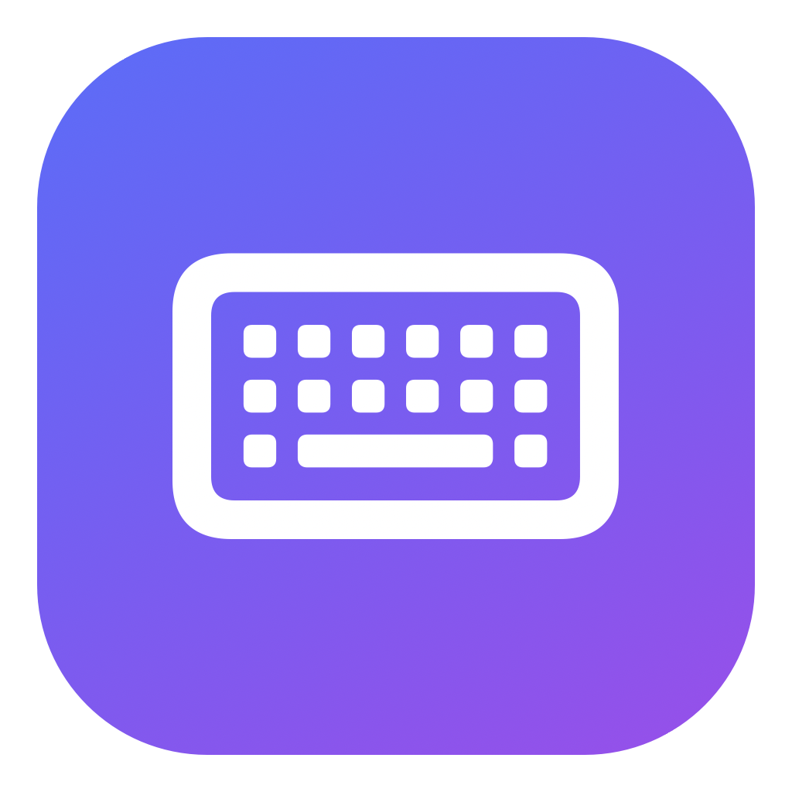

<p align="center">
  
</p>

<h1 align="center">Typer</h1>

<p align="center">Types any text into the focused field as if you were hitting the keys.</p>

<p align="center">
  
  
  
  
  
  
</p>

## Why

Some fields block paste (remote desktops, VMs, web consoles, password prompts, kiosks). Typer sends real keystrokes instead.

## Usage

1. Click into the field you want to fill.
2. Open **Typer**, paste your text.
3. Press <kbd>⌘</kbd><kbd>↵</kbd> — the launcher closes and the text is typed out.
4. Press <kbd>Esc</kbd> at any time to stop.

| Speed | Delay per key |
|---|---|
| Human | ~60–90 ms |
| Fast (default) | ~20–30 ms |
| Instant | ~5 ms |

Newlines press Return and tabs press Tab. Unicode and emoji are supported.

## Install

Requires Node.js and Xcode Command Line Tools (`swiftc`).

```sh
git clone https://github.com/brahimhamichan/typer.git && cd typer
npm install
npm run build:helper   # compiles the universal Swift typing helper
npm run build          # outputs to ~/.config/raycast/extensions/typer
```

- **Raycast:** `npm run dev` or import the folder.
- **Tinycast:** Extensions → *Import from Raycast*.

Grant your launcher **Accessibility** access (System Settings → Privacy & Security → Accessibility) so it can post keystrokes.

## How it works

The extension hands your text to a tiny Swift helper (`helper/typer.swift`) that posts `CGEvent` key events to the frontmost app, adding slight timing jitter. It polls the Escape key between characters to cancel.

## License

[MIT](LICENSE) © Brahim Hamichan
